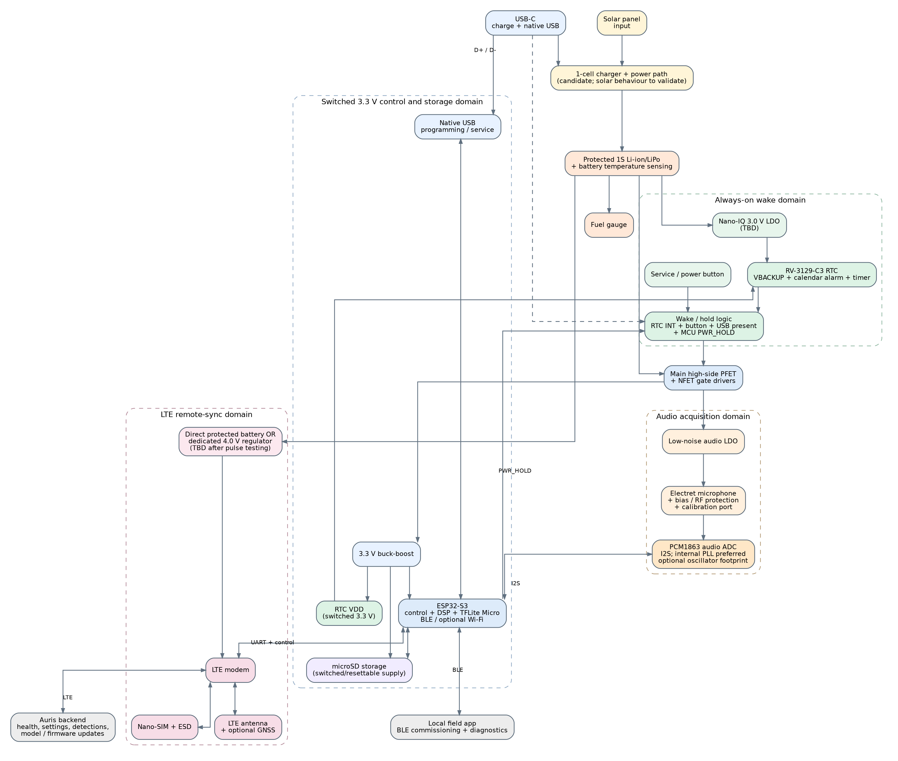

# 03 — System architecture (preliminary)

**System boundary:** Standalone recorder with always-on RTC/wake rail, switched main electronics, separate audio supply and separately enabled LTE domain; field BLE service and cloud sync are independent operating paths. This describes **intent**, not verified circuit behaviour.



## Logical diagram

```mermaid
flowchart LR
  R[RTC + service wake] --> P[Power latch / rails]
  P --> M[ESP32-S3 N16R2]
  A[Electret microphone + analogue front end] --> C[PCM1863 candidate ADC]
  C -- I2S --> M
  M <--> D[(microSD: raw audio + manifest)]
  M <-- BLE --> F[Local field setup]
  M -- UART + controls --> L[EG810M-EU LTE modem]
  L <--> B[Remote backend]
  B <--> W[Web workspace / reviewers]
  B <--> T[Model training service (future)]
  T -- validated model package --> B
```

## Architectural rules

- **Data capture must survive loss of LTE** and cannot block behind AI training, uploads or cloud availability.
- **Three independent schedules:** recording, analysis/inference (often coupled to recording completion), and remote sync.
- **Separate failure domains:** SD writes, modem transients, radio configuration and ML failures must not invalidate source recordings.
- **Duty-cycle accounting:** energy model measures wake overhead + recording + processing + LTE search/transfer + sleep overhead + always-on RTC path.
- **Explicit source of truth for time:** RTC time with synchronisation events and known uncertainty; use UTC in file manifests and explicitly store time zone at project/report level.
- **Configuration history:** each run references immutable configuration/analysis versions.
- **Local evidence:** preserve asset identity and checksum; no unlogged destructive retention.
- **Modular detector:** analysis plugin with CPU/RAM/storage budget and compatibility checks. Model deployment cannot bypass recorder safety controls.

## Interfaces to define in schematic/firmware

| Domain | Interface | Status | Review concern |
|---|---|---|---|
| RTC ↔ MCU | I²C, RTC INT and backup supply | SELECTED device; schematic OPEN | Shared active-low INT and flag clearing; isolation across off rail |
| Microphone ↔ ADC | Bias, analogue gain/filter, calibration injection if used | CANDIDATE | Acoustic self-noise, gain, EMI, overvoltage, frequency response |
| ADC ↔ MCU | I²S + clock from MCU; optional oscillator pad | CANDIDATE | PLL jitter, sample clock accuracy, sustained throughput |
| MCU ↔ microSD | SD mode, 1-bit (GPIO47/48/44); switched card supply (GPIO45) | SELECTED concept (ADR-012) | Recovery from corrupt card, reset and sustained writes |
| MCU ↔ modem | UART, PWRKEY, status, optional reset and level compatibility | CANDIDATE | Current peaks, shutdown, ESD, software fallback |
| Battery ↔ core | Protected 1S cell, charger/power path and buck-boost | CANDIDATE | Solar behaviour, cold temp, brownouts, thermal limits |
| RTC ↔ wake latch | INT/button/USB and MCU PWR_HOLD | OPEN topology | No boot race, no latch-off during SD write, default safe failure |
| USB ↔ MCU | Native USB for programming and service only, no charging (2026-10-23); ESD/CC | CANDIDATE | USB VBUS injection paths, boot modes |
| RF ↔ antenna | ESP32 antenna clearance and LTE external path | OPEN placement | Coexistence and acoustic/noise coupling |

## Deployment data lineage (proposed)

`project → deployment → recorder → recording → derived measurement(s) → candidate detection(s) → human validation → dataset snapshot → model version → staged deployment`

Avoid treating project/location and physical recorder as the same entity: a recorder can be relocated and recalibrated; a deployment binds one unit to a site and date interval. Model versions need independent provenance.

## Operating scenarios

**Offline recording:** RTC wake → record WAV + manifest → compute allowed summary → commit/flush → RTC schedule → power down.

**Remote sync:** RTC wake → check voltage and sync window → enable LTE → reconnect/upload metadata and selected clips → retrieve desired configuration/models → verify and apply at safe boundary → power down.

**Local service:** Button or USB wake → keep main rail active → BLE/USB configuration and diagnostic tests → commit settings → return to scheduled mode.

**Fault recovery:** watchdog/brownout and repeated failure counts → preserve log reason if possible → safe fallback schedule; never promise that an off-state RTC can directly repair failed power silicon.

## Architectural constraints requiring early experiments

- Expected maximum recording sample rate and whether simultaneous spectral processing is feasible.
- Model memory: the N16R2 has 2 MB quad PSRAM (8 MB on the N16R8 it replaced on 2026-11-18), and that does **not** imply every TFLite model can run; model weights can stay in the 16 MB memory-mapped flash. Benchmark activation buffers and latency.
- LTE supply pulse behaviour at low SOC and cold/high temperature.
- Analogue immunity to switching, SD writes and LTE TX; plan RF-separated enclosure compartment if test results demand.
- Solar power architecture and charge constraints, including irradiance collapse and USB coexistence.
