# 06 — Firmware behaviour, scheduling and power management

**Scope:** Firmware system design derived from the hardware draft and current product overview. Module boundaries, state names, logs and retry limits below are **proposed implementations**, not existing code.

## Power and job model

Primary energy-saving mechanism: complete switching-off of the main domain between jobs; RTC/wake remains live. Avoid calling this ESP32 "deep sleep" unless that is the **actual measured implementation**; here the hardware proposal uses external power gating.

Three different clocks/schedules:

- **Recording schedule**: windows, interval and duration; may differ by day, season or sunrise/sunset in future.
- **Analysis schedule**: metrics/detector jobs run after recording or via pre-agreed batches, bounded by battery and memory.
- **Sync schedule**: health/detections/index summaries/clip transfer; opportunistic if battery or signal is inadequate.

All scheduled times stored in UTC. A failed sync must not delete recordings or block the next record window. Clear distinction between *logical jobs due* and *physical wake cause*.

## Suggested state machine

```mermaid
stateDiagram-v2
  [*] --> OFF
  OFF --> BOOT: RTC / button / USB wake
  BOOT --> SERVICE: Button/USB service reason
  BOOT --> PREPARE: Scheduled job
  PREPARE --> RECORD: Due recording
  PREPARE --> SYNC: Due sync only + energy budget OK
  RECORD --> PROCESS: Saved WAV and metadata
  PROCESS --> SYNC: Due sync + budget OK
  PROCESS --> COMMIT: No sync / sync deferred
  SYNC --> COMMIT: Upload and command processing done/fail
  SERVICE --> COMMIT: Exit local service
  COMMIT --> OFF: Files flushed; next alarm armed; PWR_HOLD release
  BOOT --> RECOVERY: Self-test failure / corruption
  RECOVERY --> COMMIT: Safe fallback and diagnostic log
```

### Wake and shutdown ordering

1. RTC alarm (A1 one-shot or A2 standing window) asserts active-low INT, or service button/USB-present activates wake path.
2. High-side switch supplies MCU/core domain; ensure valid boot timing and reset state.
3. Early boot asserts `PWR_HOLD` **before clearing RTC flag**; measure deadline margin.
4. Read wake reason and RTC flags (A1F/A2F distinguish job alarm from sync window); record reset cause and firmware/configuration versions.
5. Decide due jobs from UTC schedule, battery/SOC estimate, storage capacity and service requests.
6. Record to temporary or final file with recoverable metadata, then close/flush; checksum/manifest after successful close.
7. Perform configured metrics and/or optional quantised inference, logging exact analysis/model version.
8. Only if scheduled and energy/radio policy permits, enable LTE, upload idempotently, fetch any changes.
9. Validate new configuration/model/firmware in staging before activation; preserve known-good fallback.
10. Close SD/files, shut down LTE cleanly, re-arm A1 (next job), leave A2 untouched, verify persistent state, release hold.

**Fail-safe rule:** If an operation exceeds its watchdog/deadline, abort nonessential work before risking the next recording; record failure reason and recover at next wake.

## Firmware components (proposed)

| Module | Responsibility | Critical tests |
|---|---|---|
| `boot_wake` | wake flags, latch, reset cause, safe hold | RTC flag race, spurious wake, brownout |
| `scheduler` | UTC jobs, policy, time uncertainty, repeated/omitted windows | DST invariance, calendar rollovers, leap date |
| `power` | rail enable, charging input sense, low-SOC policy, power profiles | cold/low cell, LTE pulse, no backfeed |
| `audio` | ADC/I²S, buffers, calibration metadata, clocks | dropout, overflow, clipping, sample jitter |
| `storage` | WAV writer, manifest/checksum, index, recovery; 1-bit SD mode on GPIO47/48/44, card power on GPIO45 (power-cycle a hung card; pins to input before power-off) | unclean reset, SD absent/full/removal, card write-latency spikes |
| `metrics` | RMS, spectra, indices and/or calibrated levels | deterministic reference vectors |
| `detector` | optional model load/quantisation/inference/score logging | model OOM, invalid package, slow inference |
| `lte_sync` | sessions, retry/backoff, chunk transfer, receipt bookkeeping; Quectel AT driver for the EG800K-EU (LTE-only hardware, no 2G) | poor signal, dropped session, duplicate upload |
| `ble_service` | field onboarding, diagnostics, auth/pairing | no internet, unauthorised pairing |
| `config` | schema validation, revisions, rollback, active config hash | invalid schedule, older schema |
| `ota` | signature/compatibility, staged install and rollback | brownout mid-update, interrupted download |
| `eventlog` | reset/fault events, health, timing and evidence | bounded ring buffer, unexpected reset |
| `console` | logs and service shell over USB-Serial-JTAG (GPIO19/20); there is no UART0 header (pins reused for the SD bus, ADR-012) | output must not block or stall when no USB host is connected |

## Power budget methodology

Per day, estimate energy rather than citing untested battery life:

\[ E_{day} \approx P_{always}\,24h + \sum_j E_{wake,j} + \sum_r P_{record,r}t_r + \sum_a E_{analysis,a} + \sum_s E_{LTE,s} \]

Measure on real boards and realistic 3G/4G/weak-signal network conditions. Include: battery charge/discharge efficiencies, regulator losses, solar irradiance and seasonal darkness, cold-weather pack capacity, panel orientation, battery-protection cut-offs, card-write peaks and false/extra wake events.

Suggested explicit energy policy: recording is highest priority; disable modem and heavy inference before skipping required reference audio. Battery critical threshold and hysteresis are **TBD**.

## Storage reliability

- Use append-safe manifests / transactional state commits; do not edit raw WAV on failed upload.
- Store raw file identity, duration/sample rate/channels, size, timestamps and hash.
- Keep an index of `captured`, `closed`, `derived`, `queued`, `uploaded`, `retained`, `pruned`, `corrupt` states; ensure restart recovery.
- Track file gaps/missed schedules as **negative operational results**, not quietly drop them.
- Define whether partial WAV header repair is safe; preserve original artifacts when recovering.

## Early experiments

1. Oscilloscope/logic-analyser wake+hold timing across cell voltage and RTC states.
2. Full-power-cycle 10k+ test target (proposal) with randomized SD present/full/error conditions.
3. Continuous 24-hour capture/clock/SD throughput prototype test, followed by duty-cycle tests.
4. Current waveform for Wi-Fi/BLE scanning, ADC capture, SD writes and LTE attach/uplink.
5. Compare audio and time continuity across UTC midnight, low battery and rejected sync.
