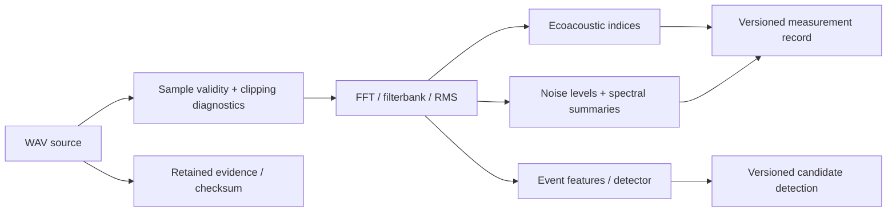

# 07 — Audio quality, acoustic indices and calibration

## Recording capabilities: configurable intent, not fixed numbers

Potential settings: capture schedule/duration, audible-band sample rate, bit depth, channels, WAV format, microphone gain, day/night windows, seasonal windows and project-specific control recordings. **No final V1 sample-rate list, SNR, self-noise, maximum SPL, frequency response or ultrasonic capability is verified in the supplied materials.** The analogue microphone + ADC need tests before publishing specifications.

### Audio integrity / identity

Each file needs a unique `recording_id`, UTC start/end, valid sample count, actual measured/derived sample rate, configuration hash, microphone/ADC ID or revision, gain, file checksum and `calibration_id`. Record discontinuities, clipping, underflow and all incomplete windows.

Use uncompressed WAV initially for interoperability; compressed formats are a separate engineering decision after testing CPU, battery and archival compatibility.

## Signal-processing chain (proposed)

### Ecoacoustic/soundscape indices (opportunities)

ACI, NDSI, Bioacoustic Index, temporal/spectral/combined entropy, Acoustic Diversity Index and Acoustic Evenness Index. Treat these as *descriptors*, **never direct species counts or biodiversity percentages**. Record each algorithm implementation version, sample rate, segment/window length, FFT size, overlap, filter bands, thresholds and background correction. Compare trends only with equivalent profiles or clearly mark profile changes.

### Complementary straightforward acoustic descriptors

RMS amplitude, peak amplitude, occupied spectrum, clipping fraction, band-limited RMS/energy, dominant frequency, spectral centroid, acoustic activity and broadband/low-frequency energy. These may be easier to interpret and communicate than composite indices.

## Environmental-noise track

Potential outputs: **LAeq / LCeq / LZeq**, weighted fast/slow maxima and peaks, sound exposure level, L10/L50/L90/L95, octave/third-octave bands, background noise and trends. Aggregate long-term daytime/evening/night indicators, including `Lden`, in backend only after ensuring local legal measurement window conventions and completeness.

**Critical engineering caveats:**

- Raw uncalibrated amplitude is **not** SPL dB re 20 µPa.
- A single 1 kHz calibration tone does not establish IEC 61672 performance across frequency/dynamic range/temperature.
- Frequency weighting, detector response, linearity, uncertainty, temporal integration and microphone response must all be validated.
- Do not claim Class 1/Class 2 IEC 61672 compliance without the appropriate comprehensive verification/certification.
- Keep noise-monitoring and wildlife-detection project displays clearly distinguishable: they have different units, quality requirements and calibration burdens.

## Calibration data model

Calibration event should include:

| Field | Description |
|---|---|
| `calibration_id` | Immutable identifier/version |
| `recorder_id`, `microphone_id` | Physical identity (support replacements) |
| `performed_at_utc` | Date and time |
| `reference_level_db_spl`, `frequency_hz` | Calibrator's nominal/measured stimulus |
| `calibrator_make_model`, `calibrator_serial` | Traceability of reference equipment |
| `frequency_response_correction` | Referenced curve/file/version when available |
| `digital_sensitivity`, `gain_profile` | Exact transform from samples to acoustic units |
| `temperature_c`, `humidity_pct` | Environmental context where available |
| `firmware_version`, `adc_config_hash` | Signal chain version |
| `operator`, `results`, `validity` | Audit trail and decision |

### Recommended field calibration UX

Pre-deployment microphone/port inspection and reference check → store calibration result → apply test schedule. Repeat post-deployment and after microphone, windscreen, membrane or housing modification. Flag excessive drift **against a documented acceptance threshold**, not an arbitrary app warning. Review suspected water ingress, blockage, condensation, gain changes and ageing.

## Acoustic validation experiments

- Mic/ADC noise-floor spectrum with DC/DC and LTE idle/TX at multiple signal levels.
- Absolute reference tone at multiple SPLs and frequencies; linearity and clipping onset.
- Measured frequency response through **final** wind/rain protective port, wet/dry, different orientations.
- Relative and (where required) absolute timestamp/sample clock accuracy.
- Comparison against a reference microphone/recorder and reference sound-level meter under repeatable stimulus.
- Battery/temperature/humidity effects and microphone swap repeatability.
- Test if feature extraction and any edge model cause dropped samples or storage timing faults.

## Calibration / method versioning rules

Never recompute historical results in place without retaining version identity. If a calibration is superseded, keep old readings and either create a new derived-series revision or distinguish correction layers. Every graph or export should identify the original file, calibration used, software version and analysis configuration.
