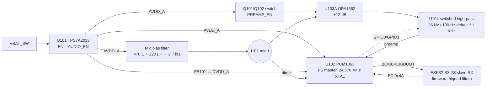

# Audio front end — schematic capture spec (prototype rev A)

**Baseline:** 2026-10-23. **Status:** **PROPOSED** design for the first prototype board, ready to capture in EasyEDA Pro. Nothing here has been built or measured. Noise, full-scale and power figures are estimates from datasheet typicals; the prototype exists to replace them with measurements (gate G2, `docs/12-TEST-AND-VALIDATION.md`).

| File | Content |
|---|---|
| [`../auris-hardware-guide.html`](../auris-hardware-guide.html) | **Start here.** One page with a tab per hardware section and LCSC codes for every major part. The *Audio front end* tab has the block drawings, wire lists and parts list; the *Nets* tab has the net finder for both sheets. Open it in a browser |
| `audio-frontend-netlist.csv` | Every pin of every part and the net it connects to (`fit` = N for do-not-place). The source of truth for connections |
| `audio-frontend-bom.csv` | Grouped BOM with the exact part number and LCSC code on every line, checked against LCSC stock and the design rules on 2026-10-25. Test pads are bare copper and have no code |
| `../tools/build_guide.py`, `../tools/guide_template.html` | Rebuild the guide after editing either CSV or `specs/lcsc-orderable-*.csv`: `python3 hardware/tools/build_guide.py`. The build stops with an error if the netlist and BOM disagree |

Datasheets used (revision-pinned): TI PCM186x **SLAS831D** (Mar 2018), TI TPS7A20 **SBVS338H** (Jul 2024), TI OPA166x **SBOS489A** (Dec 2024), Primo EM272 technical data (Jul 2017), Espressif ESP32-S3-WROOM-1 **v1.8**. Added in the 2026-11-17 review: TI TS5A23166 **SCDS196J**, TI TPD1E10B06 **SLLSEB1G**, KYOCERA AVX TAJ, KEMET T491; per-part notes in [`../datasheets/`](../datasheets/README.md).

## Block diagram

## Design decisions

| # | Decision | Rationale |
|---|---|---|
| A1 | **PCM1863 is I²S clock master from a 24.576 MHz crystal**; ESP32-S3 receives as I²S slave. Option: R102 lets the MCU drive MCLK instead | The S3 has no audio PLL: 48 kHz clocks from its 160 MHz PLL need a fractional divider (jitter). The PCM186x PGA gain ramp needs the on-chip DSP clocked, which master mode guarantees (SLAS831D §9.3.5). Sample rate is set by a ±20 ppm crystal. This **replaces** the earlier "BCK PLL preferred" note in the hardware draft |
| A2 | **Front-end path selected in software, not by analog switches.** The PCM1863 input multiplexer picks the direct or the preamp path over I²C; GPIO `PREAMP_EN` powers the preamp only when needed | No switch resistance or charge injection in a µV-level signal path, and no extra parts. Both paths can also be **recorded simultaneously** (left = direct, right = preamp) for an A/B noise comparison on identical sound |
| A3 | Mic input is **pseudo-differential**: cold leg is the mic's own return at the connector | At +32 dB PGA, differential input gives 90 dB SNR vs 75 dB single-ended (SLAS831D §7.5): 3.3 µV vs 9.4 µV input noise. Rejects noise between board ground and mic ground |
| A4 | Mic bias from AVDD (3.3 V) via 470 Ω + 220 µF, 2.7 kΩ load. PCM MICBIAS pin (2.6 V) unused | EM272 is specified at 5 V / 3.9 kΩ, 600 µA max. 2.7 kΩ is the largest load that keeps ≥ 1.4 V across the capsule FET at 600 µA from 3.3 V. The LDO's 7 µVrms would pass straight to the mic output unfiltered |
| A5 | Signal-path capacitors are **C0G or film, never X7R/X5R**; bias and DC-blocking electrolytics, including the VMID_PRE bulk cap C127, are **MnO2 tantalum** | Class II ceramics are piezoelectric: wind and rain vibration on the enclosure would become signal. Polymer capacitors leak up to 10× more than MnO2 tantalum, and that leakage would add noise to the mic bias |
| A6 | DC-carrying resistors in the mic node (R116, R117) and the preamp gain network are **thin film** | Thick film adds current-dependent excess noise |
| A7 | 0.22 µF coupling caps give a **~36 Hz analog high-pass** on both paths | Keeps wind rumble from clipping the +32 dB stage; identical corners keep the A/B comparison fair. Change to 1 µF film (~8 Hz) if sub-40 Hz targets matter |
| A8 | Audio I²C on its **own bus**, pull-ups to the audio rail | When `AUDIO_EN` is low nothing back-powers the unpowered ADC through its I/O protection diodes |
| A9 | Mic connector is 4-pin (out, source, return, shield) with R113 0 Ω source-to-return | Fits the 2-wire EM272Z1 or the 3-wire EM273 wired as 2-wire; supports a separable acoustic head (doc 18) |
| A10 | Mic 2 path fully laid out but **DNP**; op-amp channel B idles as a mid-rail follower | Stereo / hydrophone option at near-zero cost. Unused ADC inputs stay unconnected as SLAS831D §9.3.1 requires |
| A11 | **Filtering in layers, all selectable in firmware.** Only overload protection is analog (a switched high-pass on the preamp path, controlled by the PCM1863's spare GPIOs over I²C). The ADC stays at 48 kHz. Everything else is digital biquads in the ESP32-S3 | Wind and rumble must be removed *before* the gain stage or they clip it, and digital filters can't undo clipping. All other filtering is cheaper, exact and reproducible in firmware, and can be applied to the analysis copy only so the stored WAV stays wide-band evidence. Using the PCM GPIOs costs no ESP32 pins and switches off with the audio domain |

## Signal paths and register settings

PCM1863 I²C address **0x4A** (MD0 and MS/AD tied to GND). Input select registers are Page 0 `0x06` (ADC1L) and `0x07` (ADC1R); bit 6 must always be written 1. PGA registers `0x01` (L) and `0x02` (R) are two's complement in 0.5 dB steps.

| Path | ADC pins | ADC channel | Input select | PGA |
|---|---|---|---|---|
| Mic 1 direct | VIN1P/VIN1M (3/1) | ADC1L | `0x06 = 0x50` | `0x01 = 0x40` (+32 dB) |
| Mic 1 via preamp | VIN3P/VIN3M (30/28) | ADC1R | `0x07 = 0x60` | `0x02 = 0x28` (+20 dB) |
| Mic 2 direct (DNP) | VIN2P/VIN2M (4/2) | ADC1R | `0x07 = 0x50` | +32 dB |
| Mic 2 via preamp (DNP) | VIN4P/VIN4M (29/27) | ADC1L | `0x06 = 0x60` | +20 dB |
| Channel off | — | either | `0x40` | — |

| Mode | `0x06` | `0x07` | `PREAMP_EN` |
|---|---|---|---|
| A/B test (both paths of mic 1 at once) | `0x50` | `0x60` | high |
| Mono, direct | `0x50` | `0x40` | low |
| Mono, preamp | `0x40` | `0x60` | high |
| Stereo, direct (mic 2 fitted) | `0x50` | `0x50` | low |
| Stereo, preamp (mic 2 fitted) | `0x60` | `0x60` | high |

## Firmware-selectable filtering

| Layer | Where | How it is selected | Purpose |
|---|---|---|---|
| 1. Fixed analog | RF caps, 470 pF differential caps, 0.22 µF coupling caps | Not selectable | RF immunity; ~36 Hz base high-pass on both paths |
| 2. Switched analog high-pass | U104 shunts across the preamp-path ADC input | I²C → PCM1863 GPIO0/GPIO1 | Keeps wind and rumble from overloading the gain stage |
| 3. ADC | PCM1863 DSP_CTRL (Page 0 `0x71`) | Decimation filter: classic FIR (default) or low-latency IIR. ~1 Hz DC high-pass on/off | Anti-alias filter at 48 kHz (passband to 0.454 fs = 21.8 kHz); DC removal |
| 4. Firmware | ESP32-S3, on 24-bit samples before rounding to 16-bit | Config: Butterworth high-pass, low-pass, band-pass or notch, order 2–8, any corner from 20 Hz to 0.45 fs | Band-limiting, shaping for a target species, decimation to lower sample rates |

### Layer 2: switched analog high-pass (preamp path only)

The two coupling caps C122/C123 (0.22 µF each, 0.11 µF in series) feed the ADC's 40 kΩ differential input. U104 switches a shunt resistor across the pair, which raises the corner. First order on purpose: this stage is for headroom, and steep shaping is done in layer 4.

| FILT_SEL1, FILT_SEL0 | Shunt | Corner | Attenuation at 50 Hz | Write `0x14` |
|---|---|---|---:|---|
| 0, 1 — **default** (owner decision 2026-10-23) | R144 22 kΩ | ≈ 100 Hz (102 Hz) | −7 dB | `0x10` |
| 0, 0 — wide (also the state at power-up) | none | ≈ 36 Hz (set by the ADC input impedance, tolerance not specified) | −1.8 dB | `0x00` |
| 1, 0 — strong | R145 1.5 kΩ | ≈ 1.0 kHz | −26 dB | `0x20` |
| 1, 1 | both | ≈ 1.06 kHz (same use as 1, 0) | −27 dB | `0x30` |

- Set the GPIOs up once after reset: `0x10 = 0x00` (GPIO0/GPIO1 as plain GPIO), `0x12 = 0x44` (both outputs). Internal pull-downs plus R111/R112 hold both switches open until then, so the board powers up at the wide 36 Hz setting; firmware writes the configured corner (default `0x14 = 0x10`, 100 Hz) on every wake before recording.
- U104 is a **TS5A23166DCUR** (2026-11-17; the SN74LVC2G66DCUR had no stock at JLC). Same DCU pinout and active-high control (TI SCDS196J). The switch sits at the ADC's ~1.65 V input bias, inside its 0–3.3 V supply. Its ≤ 1.8 Ω on-resistance shifts the 1 kHz corner by ≈ 0.1 %, its off leakage is ≤ 50 nA, and its 6 pC charge injection is a ≈ 27 µV step into C123 (corners change only between recordings).
- R144/R145 are 1 % thick film (JLC basic): no DC flows through them, so thick film adds no excess noise. 22 kΩ instead of 22.6 kΩ moves the default corner from 100 Hz to 102 Hz.
- The 100 Hz default costs −1 dB at 200 Hz and −0.5 dB at 300 Hz, so low calls such as bittern booms and owls stay usable. About a third of this corner comes from the ADC's own input impedance, whose tolerance TI doesn't specify, so measure the real corner on the prototype.
- No analog 200 Hz step any more; a sharper 200 Hz cut for a project is a firmware filter (layer 4).
- The network settles in < 25 ms, but change the corner only between recordings.
- **Not available on the direct path:** a shunt across the mic's ~2.3 kΩ source would also attenuate the passband (−1.3 dB at the 100 Hz setting, −8 dB at 1 kHz), which adds straight to the noise. A selectable analog filter needs a buffered source, which is another point for the preamp path in the A/B decision.
- To change a corner, change the resistor: R = 1 / (1/R∥ − 1/40 kΩ), where R∥ = 1 / (2π · f_c · 0.11 µF).

### Layer 3: ADC settings

| Setting | `0x71` value |
|---|---|
| Classic FIR + DC high-pass (reset default, recommended) | `0x10` |
| Low-latency IIR + DC high-pass | `0x30` |
| Classic FIR, DC high-pass off | `0x00` |

FIR: stopband from 0.583 fs at −65 dB, 30-sample delay. IIR: stopband from 0.546 fs at −75 dB, 10-sample delay (SLAS831D §7.7). Keep the ADC at **48 kHz**: the 24.576 MHz crystal is exactly 512 × fs there. Other rates need non-standard divider ratios and would change the operating point that calibration depends on. Produce lower output rates by decimating in firmware (layer 4).

### Layer 4: firmware filters (ESP32-S3)

- Cascaded biquads in float32 on the 24-bit samples, then rounding to 16-bit. The analog noise sits above the 16-bit floor, so it acts as dither. Espressif's ESP-DSP library has biquad and coefficient-generator routines.
- Cost: four biquads at 48 kHz is about 1 M multiply-adds/s, well under 1 % of the CPU.
- Two separate filter chains in config:
  - **`record_filter`** is applied before the WAV is written, so it is destructive. **Default: none.**
  - **`analysis_filter`** is applied only to the copy used for metrics and detection, so the WAV stays wide-band.
- The mic fingerprint (F1-04) is computed before any firmware filter. Compare it only between recordings with the same analog corner.
- The front-end path, analog corner, ADC filter settings and the full digital chain (type, order, corners, coefficient hash) go into every file's metadata and the manifest (F8-01). GUANO has standard `Filter HP` and `Filter LP` fields for the effective corners. Put the full chain in an Auris-specific field.

## Sheet ports and proposed ESP32-S3 pins

GPIO numbers are **proposed** and avoid strapping pins (0, 3, 45, 46), USB (19, 20) and octal-PSRAM pins (35–37, unavailable on N16R8). Final allocation belongs to the whole-board pin map (backlog H0-06); the MCU tab of the hardware guide has every section's pins.

| Port | Direction (MCU view) | Proposed GPIO | Notes |
|---|---|---|---|
| `VBAT_SW` | power in | — | Switched battery rail after the main high-side switch |
| `AUDIO_EN` | out | GPIO7 | High = audio domain on |
| `PREAMP_EN` | out | GPIO6 | High = preamp powered |
| `AUD_BCK` | in | GPIO15 | 3.072 MHz from ADC |
| `AUD_LRCK` | in | GPIO16 | 48 kHz from ADC |
| `AUD_DOUT` | in | GPIO17 | |
| `AUD_SDA` | bidir | GPIO18 | I2C1, pull-ups on this sheet |
| `AUD_SCL` | out | GPIO8 | |
| `AUD_INT_MCU` | in | GPIO4 | Via DNP R109 |
| `AUD_MCLK` | out | GPIO9 | Via DNP R102 (clock fallback only) |
| `MIC1_DC_SENSE` | analog in | GPIO5 (ADC1_CH4) | Via DNP R118/C115; reads the mic FET drain voltage |

**Firmware rule:** whenever `AUDIO_EN` is low, all `AUD_*` pins are inputs with no pull-ups and `PREAMP_EN` is low.

## Calculations

### Mic operating point (EM272, R116 470 Ω + R117 2.7 kΩ from 3.3 V)

| Capsule current | Drain voltage | Comment |
|---:|---:|---|
| 0.3 mA | 2.35 V | Typical-range capsule |
| 0.6 mA (datasheet max) | 1.40 V | Worst case; still above FET pinch-off for typical electret JFETs. **Verify on samples** |

Expected sensitivity ≈ −28 dB − 20·log(3.9 k / 2.7 k) − ~1.3 dB loading (20 kΩ ADC input ∥ 100 kΩ preamp bias) ≈ **−32 dBV/Pa (~24 mV/Pa)**, assuming the capsule FET output resistance ≫ the load. Off the datasheet's 5 V / 3.9 kΩ condition, so measure.

### Noise and full scale (A-weighted, estimated)

PCM1863 input-referred noise from SLAS831D §7.5 SNR figures (A-weighted): 13.3 µV at 0 dB, 3.3 µV at +32 dB differential. A two-term model (PGA noise + ADC noise ÷ gain) fitted to those two points gives ~3.6 µV at +20 dB; TI does not publish intermediate gains, so treat that as an estimate.

| Path | Electronics noise at mic | Mic self-noise (14 dBA ≈ 2.4 µV here) | System self-noise | Full scale |
|---|---:|---:|---:|---:|
| Direct, PGA +32 dB | 3.3 µV | 2.4 µV | **≈ 19 dBA** | ≈ 107 dB SPL |
| Preamp +12 dB, PGA +20 dB | ≈ 1.1 µV | 2.4 µV | **≈ 15 dBA** | ≈ 107 dB SPL |

16-bit storage floor (−98 dBFS) sits ≈ 9 dB below the direct-path noise and ≈ 6 dB below the preamp-path noise, so the D7 16-bit decision costs ≤ 1 dB. The preamp output peaks at ≈ 1.2 Vpp at full scale, inside the OPA1662's 0.6–2.7 V swing on 3.3 V; its input sits at 1.65 V, inside the 0.5–2.3 V common-mode range.

### Filter corners

| Network | Corner |
|---|---|
| Mic bias filter (470 Ω, 220 µF) | 1.5 Hz low-pass |
| Coupling 0.22 µF into ADC 20 kΩ input (both paths) | ≈ 36 Hz high-pass |
| Preamp input 0.22 µF into 100 kΩ | 7 Hz high-pass |
| Preamp Cg 100 µF with Rg 1 kΩ | 1.6 Hz (DC gain 1) |
| 470 pF differential cap with ≈ 2.3 kΩ mic source | ≈ 145 kHz low-pass (−0.1 dB at 20 kHz) |

TI's line-input filter (47 Ω + 10 nF, SLAS831D Fig. 63) must **not** be copied here: with a 2.4 kΩ mic source it forms a ~6 kHz low-pass.

### Audio domain power (from 3.7 V battery through the linear LDO)

| Load | Current |
|---|---:|
| PCM1863 active, 2-ch (AVDD 18 mA + IOVDD 6.2 mA) | 24.2 mA |
| Master mode + crystal oscillator | 2.5 mA |
| Mic bias (max) | 0.6 mA |
| **Direct path total** | **≈ 27 mA → ≈ 100 mW** |
| Preamp (OPA1662 both channels + mid-rail divider) | + 3.2 mA → **≈ 113 mW** |

That is roughly a third of the F4-06 recording budget (≤ 350 mW), leaving ~240 mW for the ESP32-S3 and SD card. LDO regulation holds down to VBAT ≈ 3.32 V (145 mV max dropout at 300 mA, ≈ 15 mV at 30 mA); recording stops at 20 % SOC (F4-03), well above that. Below it AVDD_A follows VBAT_SW less ≈ 15 mV (SBVS338H §6.4.3), and the PCM1863 has no brown-out detector or reset pin (SLAS831D §7.3, §11.3). **Recording gate (2026-11-17 review):** start a recording only with VBAT_SW ≥ 3.35 V measured under load, and check the clock registers in step 11 before every recording.

### Settling after power-up

Mic bias RC τ = 0.1 s; preamp Cg τ = 0.1 s; mid-rail τ = 0.05 s. Allow **≥ 0.5 s direct, ≥ 1 s preamp** after enabling before audio is valid. Firmware should wake ~3 s before each slot so recording starts on time (F1-02); 2 s of extra audio-domain on-time per slot costs ≈ 0.01 Wh/day, inside the 1.25 J-per-wake allowance in doc 19.

## Firmware bring-up sequence

1. Set `AUD_*` pins as inputs (no pulls), `PREAMP_EN` low.
2. `AUDIO_EN` high; wait ≥ 10 ms (LDO soft start, PCM power-on reset; the PCM has no reset pin).
3. Page 0, then software reset: `0x00 = 0x00`, `0x00 = 0xFE`, `0x00 = 0x00`.
4. `0x20 = 0x91`: crystal as SCK, master mode, auto clock detect on.
5. `0x26 = 0x07` (SCK ÷ 8 → BCK 3.072 MHz), `0x27 = 0x3F` (BCK ÷ 64 → LRCK 48 kHz).
6. `0x0B = 0x44` (I²S, 24-bit; the reset default, write explicitly).
7. Input select and PGA per the mode table; the PGA ramps to target in 0.5 dB steps at zero crossings.
8. Filters: `0x10 = 0x00`, `0x12 = 0x44` (GPIO0/1 as outputs), then `0x14` for the analog corner and `0x71` for the ADC filter (see filtering tables).
9. Mic-bias regulator off (MICBIAS pin 5 is unused; Page 3 `0x15` resets to `0x01`, which powers it up, SLAS831D Table 121): `0x00 = 0x03`, `0x15 = 0x00`, `0x00 = 0x00`.
10. If using the preamp, `PREAMP_EN` high.
11. Read back `0x72` (expect `0x0F`), `0x73` (`0x03`) and `0x74` (`0x34`) to confirm clocks; on a mismatch cycle `AUDIO_EN` and start again. Wait the settling time.
12. ESP32-S3 I²S slave RX, Philips format, 32-bit slots, stereo; keep the top 24 bits.
13. Power down: `PREAMP_EN` low, `AUDIO_EN` low, return pins to inputs. Drive `AUDIO_EN` low early in every boot: GPIO7 has no pull at reset and the TPS7A20's 500 kΩ pull-down is switched out while EN is high.

## Capture notes for EasyEDA Pro

- Use the net names in the netlist exactly; they are referenced by firmware notes and test procedures.
- One `GND` net for AGND and DGND (TI recommends a single plane, SLAS831D §12.1.1). Mic returns join `GND` **only** through R114 (R138 for mic 2), placed at the connector.
- Mark `fit = N` parts as do-not-place so they keep footprints but leave the assembly BOM.
- Q101/Q102: pin 1 = G, 2 = S, 3 = D in the AOS drawings and the EasyEDA symbols (checked 2026-11-17).
- C127 and the other tantalums: pad 1 is + on the EasyEDA footprints; the netlist uses pin numbers 1/2.
- U103 (OPA1662): the EasyEDA symbol's part B carries V+ as pin 8 and V− as an internal pin 9. After capture, check that PCB pad 4 is GND and pad 8 is AVDD_PRE and that no pad-9 error appears.
- D101: the library footprint's pads (0.6 × 0.6 mm, 1.0 mm apart) are larger than TI's DPY0002A land pattern (0.3 × 0.5 mm, 0.7 mm apart, SLLSEB1G pp. 19–20); use TI's pattern or inspect the first boards for skew.
- Prefer JLC basic parts for passives where the dielectric/film requirement allows.

## Layout rules

1. Keep the PCM1863 analog pins (1–8, 27–30) facing the mic connector and preamp; digital pins (9–26) toward the MCU (SLAS831D Fig. 74).
2. Decoupling caps on the same layer as the IC, no vias between cap and pin.
3. Route each ADC input pair as a coupled pair with ground on both sides; place C118/C124 and the 47 Ω resistors at the ADC pins.
4. MIC1_OUT trace short, guarded by ground, away from the crystal, I²S lines, buck-boost loop, SD bus and LTE antenna feed.
5. Crystal and load caps tight to pins 9/10 with a ground guard ring.
6. AVDD_A star from C102: separate branches to ADC AVDD, mic bias filter, preamp switch.
7. Leave space and pads for a shield can over the analog section (fit only if G2 shows radiated pickup).

## What the prototype must measure (feeds G2)

| Test | Purpose |
|---|---|
| Noise floor of both paths at once (A/B mode) in a quiet box, with buck-boost, SD writes and LTE idle/TX active and inactive | Decides direct vs preamp for V1; checks EMI |
| Mic drain voltage on 10+ capsule samples | Confirms 2.7 kΩ / 3.3 V headroom across capsule spread |
| Sensitivity at 94 dB SPL / 1 kHz per unit and path | Factory gain trim (D7) and unit-to-unit spread |
| Clipping onset vs SPL | Confirms ≈ 107 dB SPL full scale |
| Frequency response through the final acoustic port | Confirms the 36 Hz corner choice |
| Tap/vibration test on enclosure | Confirms no microphonic pickup from passives |
| Supply current per mode | Replaces the power table above |
| Sample-rate accuracy (LRCK vs reference) | Confirms crystal tolerance |
| Swept sine at each analog high-pass setting, and THD with the switch open and closed | Confirms the 36 / 100 / 1000 Hz corners and that U104 adds no audible distortion |
| Outdoor wind exposure at each analog setting, counting clipped samples | Shows whether the 100 Hz default protects headroom in wind, or a steeper (2nd-order) stage or higher per-project corner is needed |

## Open items

- **Supply:** PCM1863 stock at LCSC was 1 unit in July. Check PCM1863DBT/DBTR and the footprint-compatible PCM1862 before ordering. At +32 dB the PGA noise dominates, so the PCM1862 should perform about the same for this mic use (its 7 dB lower SNR applies at 0 dB line level). Confirm on the bench.
- **Microphone part number:** decide EM272Z1 (2-wire) or EM273 (3-wire); the board takes either.
- **Crystal:** choose a specific part, then set C111/C112 from its CL.
- **Mechanical:** connector type and cable depend on the acoustic head design (ADR-020).
- **Selection inputs:** if the preamp path wins, V1 can drop the direct path (or vice versa) and remove the switch FETs. If the direct path wins, the switched analog high-pass goes with the preamp.
- **Filter corners:** default ≈ 100 Hz (owner decision 2026-10-23), with 36 Hz (wide) and 1 kHz (strong) selectable. If the wind test shows clipping at 100 Hz, add a 2nd-order stage rather than raising the default above where low-frequency species call.
