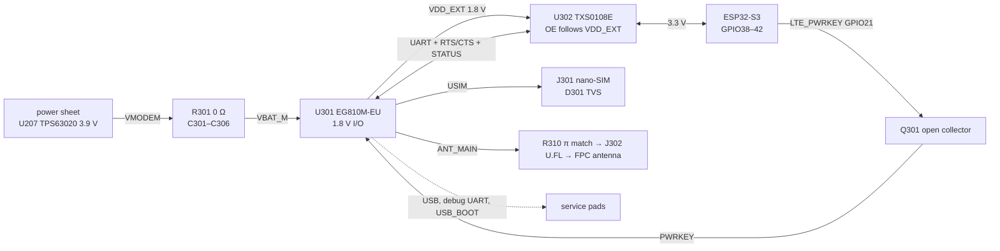

# LTE sheet — schematic capture spec (prototype rev A)

**Baseline:** 2026-10-23. **Status:** **PROPOSED** design for the first prototype board, ready to capture in EasyEDA Pro. Nothing here has been built. The modem is the Quectel **EG810M-EU** (`EG810MEULA-I05-SNNSA`, C20421924; ADR-006, owner decision 2026-11-18): LTE Cat 1 (10 Mbps down, 5 Mbps up), bands B1/3/5/7/8/20/28, approved for Europe, Australia and New Zealand, no 2G. It replaced the EG800K-EU (`EG800KEULC-I03-SNNSA`, C44008839, Cat 1 bis), which had no JLC stock on 2026-11-18. Quectel states the EG810M-EU is compatible with the EG800K series in package, so the footprint still takes an EG800K-EU.

| File | Content |
|---|---|
| [`../auris-hardware-guide.html`](../auris-hardware-guide.html) | **Start here.** The *LTE* tab has the block drawings, wire lists, sheet ports and parts list; the *Nets* tab checks a capture against all three sheets. Open it in a browser |
| `lte-netlist.csv` | Every pad of every part and the net it connects to, including all 109 module pads. `NC` marks a pad left open, not a net |
| `lte-bom.csv` | Grouped BOM with MPNs and LCSC codes; the two π-match caps are DNP with no value until antenna tuning |
| `../tools/build_guide.py` | Rebuild the guide after editing either CSV: `python3 hardware/tools/build_guide.py`. The build also checks the hand-drawn module pin map against the netlist |

**Sources.**
- **Pinout and circuits:** drawn from Quectel *EG800K-LA Hardware Design* V1.0.0, 2024-05-23, status preliminary, from the FCC filing ([fccid.io/XMR2024EG800KLA](https://fccid.io/XMR2024EG800KLA/User-Manual/User-Manual-7421892.pdf)). Checked on 2026-11-18 against Quectel *EG810M-EU QuecOpen&QuecPython Hardware Design* V1.0, 2024-06-25, status released ([`../datasheets/pdf/Quectel_EG810M-EU_QuecOpen_QuecPython_HD_V1.0.pdf`](../datasheets/pdf/Quectel_EG810M-EU_QuecOpen_QuecPython_HD_V1.0.pdf)), the first EU-variant manual Auris has: every pin Auris connects (1, 7, 10–18, 22–25, 27, 34–43, 45–48, 59–61, 70–73, 82, 88–95) has the same function as on the EG800K, and the GND pin list is identical. Pins Auris leaves open carry QuecOpen-only functions on the EG810M (e.g. pin 8 = CAM_VDD, a 2.8 V output) and stay open. The standard-firmware *EC800M & EG810M Series Hardware Design* has not been read (open item 1).
- **Component values:** Quectel *EC800K & EG800K Series QuecOpen Reference Design* V1.2, 2025-02-26 ([developer.quectel.com](https://developer.quectel.com/en/wp-content/uploads/sites/2/2025/06/Quectel_EC800KEG800K_Series_QuecOpen_Reference_Design_V1.2.pdf)): VBAT capacitor array, translator, SIM network. The EG810M-EU hardware design asks for the same VBAT array (§3.4.4, Fig. 6), PWRKEY driver (Fig. 7), SIM network (Fig. 18) and TXS0108EPWR translator with OE divided from VDD_EXT (Fig. 19).
- **Bands and approvals:** Quectel *EG810M-EU Specification* V1.1 (the *EG800K Series Specification* V1.3 for the EG800K-EU).
- **Parts:** TI TXS0108E **SCES642L** (Nov 2024); Semtech SRV05-4 (rev 08/11/04); SOFNG SNO-1303-C drawing (contact map C1–C7, card detect); Quectel EG810M-EU Specification V1.1 (LTE-FDD B1/3/5/7/8/20/28, no TDD, CE and RCM, −35…+75 °C operating, −40…+85 °C extended, LGA 17.7 × 15.8 × 1.7 mm; the EG800K-EU is 2.4 mm thick). Per-part notes in [`../datasheets/`](../datasheets/README.md).
- **Filter footprints:** C317–C323 (33 pF, not fitted) sit at the used UART/status pins, as the QuecOpen reference asks (sheet 3 note 9); fit them only if EMC testing needs them.

Designators run from 301. Shared nets: `VMODEM` and `3V3` with the power sheet, `GND` with all sheets.

## Block diagram

## Design decisions

| # | Decision | Rationale |
|---|---|---|
| L1 | **VBAT from the switched 3.9 V rail** through a 0 Ω link, with Quectel's array: 100 µF polymer (ESR 70 mΩ) + 100 nF, 33 pF, 10 pF, 3.9 pF, 1.8 pF | Quectel asks for ≥ 100 µF with ESR ≤ 0.7 Ω and the MLCC array at the pins, and a supply able to deliver 2 A (EG810M-EU HD Table 10, §3.4.4, Fig. 6; VBAT 3.4–4.3 V, 3.8 V nominal). The TPS63020 rail (power sheet) does; its 470 µF sits at the converter (the D205 TVS is not fitted). A standard tantalum (1.7 Ω) does not meet the ESR limit |
| L2 | **Level-shift UART, RTS/CTS and STATUS with a TXS0108EPWR** powered on the A side from the module's VDD_EXT | Module I/O is 1.8 V; the ESP32 is 3.3 V. Quectel recommends this part. Because its A side and OE come from VDD_EXT, the translator is Hi-Z whenever the modem is off, so ESP32 pins cannot back-power the module (a common cause of modems that will not restart) |
| L3 | **OE follows VDD_EXT** through the R304 100 kΩ / R305 1 MΩ divider (OE = 0.91 × VDD_EXT); C307 not fitted (2026-11-17 review) | TI limits the OE input edge to 10 ns/V (SCES642L §5.3) and wants OE low as VCCA falls (§8.3); an RC broke both. OE crosses its 0.65 × VCCA threshold as VDD_EXT reaches ≈ 1.3 V, and Quectel's reference uses a divider without a capacitor |
| L4 | **Hardware flow control fitted** (RTS/CTS) | Quectel recommends it for stable UART. If the ESP32 runs out of pins (see below), drop RTS/CTS first: the heartbeat is ≤ 1 KB at 115200 baud |
| L5 | **PWRKEY by open-collector NPN** (Q301), with Quectel's 10 nF (C316) at the pin, not tied low | Tying PWRKEY low turns the module on automatically but makes it restart after `AT+QPOWD`, so the rail would be cut mid-boot. A driven PWRKEY allows a clean shutdown before MODEM_EN goes low. EG810M-EU HD Fig. 7 shows the same driver and 10 nF; §3.7 note 2 limits PWRKEY and RESET_N to ≤ 10 nF |
| L6 | **RESET_N not driven**, test pad only | Quectel: use RESET_N only if `AT+QPOWD` and PWRKEY both fail (EG810M-EU HD §3.7: pulse ≥ 300 ms, test point recommended if unused). The last resort here is cutting MODEM_EN, which saves a GPIO |
| L7 | **SIM network per Quectel** (holder SNO-1303-C is push-push; its 4 cover pads go to GND): 0 Ω links, 33 pF to GND, 100 nF on USIM_VDD (< 1 µF), 15 kΩ data pull-up, TVS array < 15 pF, all at the holder; hot-plug detect unused | The SIM is only read during the daily session; the card is not swapped in the field. Same network as EG810M-EU HD Fig. 18 (6-pin holder, USIM_DET open) |
| L8 | **USB, debug UART and USB_BOOT to test pads only** | Quectel requires test points for module firmware updates (QFlash ≥ 6.0 over USB) and logs (EG810M-EU HD Tables 15, 16 and 20). USB_BOOT (pin 82, 1.8 V, active low) goes through 4.7 kΩ to a GND test point and must not be low before start-up (§4.2). Updates can also go over the air (DFOTA) |
| L9 | **π match at the U.FL**, R310 0 Ω fitted, C314/C315 DNP | Quectel reference; values come from tuning with the real antenna in the enclosure |

## ESP32 pins (proposed, H0-06)

| Signal | GPIO | ESP32 setting |
|---|---|---|
| LTE_TX | 39 | UART1 TX |
| LTE_RX | 40 | UART1 RX, internal pull-up (line is Hi-Z while the modem is off) |
| LTE_RTS | 41 | UART1 RTS |
| LTE_CTS | 42 | UART1 CTS, internal pull-up |
| LTE_STATUS | 38 | Input, internal pull-down (reads low while the modem is off) |
| LTE_PWRKEY | 21 | Output, low by default; R303 holds Q301 off during boot |

GPIO39–42 are the external JTAG pins; debugging moves to the ESP32-S3's built-in USB-JTAG on GPIO19/20. **Pin budget:** resolved 2026-10-23 (ADR-012): the microSD bus uses GPIO47/48/44, card power GPIO45 and the status LED GPIO43, freed by moving the console to USB. Flow control and MODEM_PG stay.

## Power-up and shutdown sequence (firmware)

1. `MODEM_EN` high (power sheet). Wait for `MODEM_PG` high (read it only after `MODEM_EN` is high; it flags the end of current-limited start-up), then **at least 30 ms** more for VBAT to settle. Never enable the modem rail during a recording: its start-up into ≈ 600 µF can sag VBAT_SW by 1 V or more.
2. `LTE_PWRKEY` high for **800 ms** (PWRKEY low ≥ 700 ms, EG810M-EU HD §3.5.1), then low.
3. Wait for `LTE_STATUS` high (≥ 6 s after PWRKEY in EG800K-LA HD Fig. 11, ≥ 5 s in EG810M-EU HD Fig. 9; the translator enables as VDD_EXT rises). The UART is active only ≥ 10 s after PWRKEY (both manuals): wait for `RDY` or retry `AT` on UART1 at 115200 baud. Keep `AT+QSCLK=0`: with MAIN_DTR open the ESP32 cannot wake a sleeping module.
4. Run the session: attach, heartbeat, config, clock sync.
5. Send `AT+QPOWD`, wait for `LTE_STATUS` low (allow tens of seconds), then `MODEM_EN` low. Keep `LTE_PWRKEY` low throughout, or the module turns itself back on.
6. If there is no response: pulse `LTE_PWRKEY` for 650 ms or more and wait again. Cut `MODEM_EN` only as the last resort; Quectel warns that cutting power while the module runs can corrupt its flash.

## Bring-up tests (rev A board)

1. **Off state:** modem rail off, ESP32 running. No voltage on VBAT_M or VDD_EXT; LTE_RX, LTE_CTS and LTE_STATUS read as the ESP32 pulls set them (translator Hi-Z).
2. **Power-up:** sequence above. Check VBAT_M, VDD_EXT = 1.8 V, OE tracking VDD_EXT (0.91 ×) on a scope, STATUS high, `AT` → `OK`.
3. **SIM:** `AT+CPIN?` → `READY` with 1.8 V and 3.0 V cards.
4. **Attach and transmit:** register on B20/B28 (rural Europe/Australia) and B3; measure VBAT_M droop and module current through R301 (lifted, ammeter in its place) at full transmit power (weak signal or attenuator), at 3.0 V battery, room temperature and −10 °C.
5. **Shutdown:** `AT+QPOWD` → STATUS low → rail off; repeat 100 power cycles without a failed start.
6. **Service pads:** forced download over USB with QFlash (BOOT_PAD shorted to GND at power-on); debug UART log at 115200 baud.
7. **RF:** conducted check at J302, then over the air with the FPC antenna in the closed enclosure; tune C314/C315 if return loss needs it.

## Open items

| # | Item | Detail | Next step |
|---|---|---|---|
| 1 | EU pin table | Drawn from the EG800K-LA manual (preliminary). **Largely resolved 2026-11-18:** the released EG810M-EU QuecOpen&QuecPython hardware design V1.0 confirms the function of every pin Auris connects and the GND pin list. That is the QuecOpen manual; the standard-firmware manual has not been read | Read the *EC800M & EG810M Series Hardware Design* (standard firmware) and confirm the same pins there |
| 2 | Transmit current | The LA manual lists full-power transmit current as TBD. The power sheet assumes about 0.65 A (A7670G figure). The EG810M-EU HD lists 526–633 mA typical during LTE data transmission (Table 42, power level not stated) and a peak of 1.5 A typical, 2 A maximum at maximum power (Table 41) | Measure in test 4; recheck the battery fuse margin (power sheet open items) |
| 3 | VBAT TVS | Quectel recommends a TVS with VRWM 4.7 V at the module supply. The SMAJ5.0A from Hub v2 (D205) broke down at ≥ 6.4 V and clamped near 9.2 V, above the module's 6 V absolute maximum (EG810M-EU HD Table 40, as for the EG800K), so it is **not fitted** (owner decision 2026-11-17); the footprint stays | Rev B: a ≤ 4.7 V VRWM TVS that clamps below 6 V, or none (the rail is internal and regulated) |
| 4 | PCB stack-up | Quectel recommends at least four layers, a solid ground under the module, nothing on the top layer beneath it, a 50 Ω antenna feed and 90 Ω USB pairs | Decide the stack-up for the whole board before layout |
| 5 | Stock | EG810M-EU: **206 at JLC** on 2026-11-18. The EG800K-EU fell from 4 at JLC on 2026-11-17 to 0 on 2026-11-18 (151 at LCSC and 179 at JLC on 2026-10-23), which is why it was replaced (review W1). FPC antenna TX4G-FPC-8121: 128 | Buy the prototype quantity early; find a second antenna that covers 700–2700 MHz |
| 6 | SIM | Push-push nano-SIM holder (consumer part, −35…+75 °C) in a damp enclosure; SIM plan and operator acceptance (e.g. Telstra in Australia) open | Consider a solder-down MFF2 eSIM in rev B |
| 7 | Compliance | The module carries CE and RCM, but the finished recorder still needs its own RED (Europe) and RCM (Australia) assessment | Plan with the enclosure and antenna (ADR-020) |
| 8 | Firmware | New Quectel AT driver, needed for the EG810M-EU as for the EG800K-EU; FieldMesh has only an A7670G driver | Backlog for the firmware sync module (`lte_sync`) |
| 9 | Footprint | The EasyEDA symbol's pin names match the netlist; its footprint is `LGA-109_L17.7-W15.8-P1.10_EG810M-CN` (the EG800K-EU's was `LGA-109_L17.7-W15.8-AIR780E`, whose outer pads review L9 found larger than the LA manual's). The PCB footprint still accepts an EG800K-EU | Compare the pad geometry with EG810M-EU HD Fig. 40 (recommended footprint) at layout |
