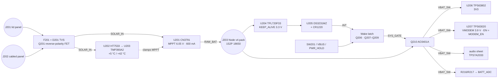

# Power sheet — schematic capture spec (prototype rev A)

**Baseline:** 2026-10-23. **Status:** **SELECTED IN CONCEPT** circuits, ready to capture in EasyEDA Pro. Nothing here has been built or measured on an Auris board. The circuits come from FieldMesh boards that are designed and reviewed but not field-proven; only the modem rail has a recorded bench pass (doc 20).

| File | Content |
|---|---|
| [`../auris-hardware-guide.html`](../auris-hardware-guide.html) | **Start here.** The *Power* tab has the block drawings, wire lists, sheet ports and parts list; the *RTC & wake* tab has the RTC and wake latch; the *Nets* tab checks a capture against this sheet and the audio sheet. Open it in a browser |
| `power-netlist.csv` | Every pin of every part and the net it connects to. The source of truth for connections. `NC` marks an unconnected pin, not a net |
| `power-bom.csv` | Grouped BOM with MPNs and LCSC codes for every line except the test pads |
| `../tools/build_guide.py` | Rebuild the guide after editing either CSV: `python3 hardware/tools/build_guide.py`. The build stops with an error if the netlist and BOM disagree, a designator is used on both sheets, or a sheet port is missing from the netlist |

**Sources.** FieldMesh repo `~/Documents/projects/Data-Logger-network---ESP32`: Node v4 prototype release 2026-10-22 (panel input, charger, temperature cut-out, battery input, keep-alive rail, battery sense) and Hub v2 r6 2026-10-10 (TPS63020 modem rail). The wake latch is common to both. Connections were taken from their pad-level EasyEDA netlists. Review and comparison: [`docs/20-FIELDMESH-POWER-AND-MODEM-REVIEW.md`](../../docs/20-FIELDMESH-POWER-AND-MODEM-REVIEW.md).

**Datasheets checked** (revision-pinned): Analog Devices DS3231M **19-5312 Rev 7** (Mar 2015), TI TMP390 **SBOS904A** (Aug 2020), TI TPS63802 **SLVSEU9D** (Jan 2021), TI TPS63020 **SLVS916I** (Oct 2019). Re-checked in the 2026-11-17 review: Consonance CN3791 **Rev 1.0**, Holtek HT75xx-1 **Rev 2.81**, 3PEAK TPL720 **Rev A.2**, Littelfuse 1812L (07/21/17), Nexperia PMEG4010CEH **Rev 02** and the discretes; per-part notes in [`../datasheets/`](../datasheets/README.md).

Designators run from 201 (audio uses 101–147). Shared nets with the audio sheet: `GND` and `VBAT_SW`.

## Block diagram

## Design decisions

| # | Decision | Source and rationale |
|---|---|---|
| P1 | **CN3791 buck MPPT charger**, 600 mA, series Schottky against night back-feed | Node v4. Holds the panel at its maximum-power voltage; roughly a third more energy than a linear charger from the same panel (estimate, doc 20). ADR-007 |
| P2 | **TMP390A2 cut-out clamps the MPPT pin**; cold trip **+5 °C** (owner decision 2026-11-17; was 0 °C from 2026-10-23, FieldMesh +5 °C). Below 0 °C the TMP390A2 is only specified to ±2.5 °C, so the 0 °C setting could charge down to −2.5 °C; at +5 °C its 0–70 °C accuracy (±1.5 °C, SBOS904A §6.5) puts the trip at +3.5…+6.5 °C, at the cost of winter charging | Li-ion must not charge below 0 °C. +5 °C blocks more December charging at 50–56°N (F4-01): watch the winter energy balance. Panel-powered, so it costs nothing at night |
| P3 | **Two panel inputs in parallel**, no USB charging. **6 V-class panels only** (Voc ≤ 10 V at −40 °C): D201 starts conducting at 13.3 V, so a 12 V panel (Voc 22–25 V) would burn it | Integrated and cabled panels both supported (ADR-022). A 5 V USB input sits below the 6 V MPPT point and cannot share the CN3791. USB is service only and wakes the board |
| P4 | **FieldMesh Node v4 battery pack** (protected 1S2P 18650, ≈ 5200 mAh, ≥ 600 mA charge, ≥ 1.5 A discharge) on a keyed JST PH | Owner decision 2026-10-23 (ADR-022); shared supply and harness with FieldMesh |
| P5 | **TPL720F33 keep-alive** for the RTC and latch only; **CR1220** on RTC VBAT | Node v4 / Hub v2. 1.4 µA quiescent; time survives a flat battery (F4-04). ADR-010 |
| P6 | **FieldMesh wake latch** with the RTC-inverter resistors raised from 100 kΩ to **1 MΩ** | ≈ 5 µA instead of ≈ 46 µA idle. Wake sources wired-OR: RTC alarm, PWR_HOLD, VBUS (new), button. ADR-003 |
| P7 | **TPS63802 main 3.3 V**, power-save mode, always on while awake; its power-good holds the ESP32-S3 EN low until 3V3 is up (2026-11-17) | Node v4. Holds 3.3 V down to an empty cell. ADR-008 |
| P8 | **TPS63020 3.9 V modem rail**, forced PWM, EN and PG (1 MΩ pull-up) to the MCU, 470 µF bulk, for the **EG800K-EU** (3.4–4.3 V, LTE only). D205 (SMAJ5.0A) not fitted since 2026-11-17 | Hub v2 r6, bench-tested there with an A7670G. ADR-011. The EG800K-EU (ADR-006) has no 2G, so no 2 A GSM bursts. The bulk capacitance may be more than it needs; keep it for the prototype |
| P9 | **Battery state from an ADC divider on VBAT_SW**; no fuel gauge. A second divider reads the panel | Node v4. No sleep drain; saves the MAX17048 (1.51 USD). ADR-027 |

## Calculations

| Item | Formula | Result |
|---|---|---|
| MPPT set point | 1.205 V × (1 + R204/R205) = 1.205 × (1 + 402k/100k) | **6.05 V**, for the Node v4 panel |
| MPPT for another panel | R204 = R205 × (Vmp / 1.205 V − 1), R205 = 100 kΩ | e.g. Vmp 5.5 V → 356 kΩ (use 357 kΩ) |
| Charge current | 120 mV / R202 = 0.12 / 0.200 | **600 mA** (550–650 mA); R202 dissipates 72–85 mW |
| Charger inductor | L > 5 × (VCC − VBAT) µH and ripple ≤ 0.3 × ICH (CN3791 Rev 1.0 p.8) | ≥ 27 µH at the cold Voc (8.3 V) and a 3.0 V cell, ≥ 38 µH for the ripple rule: **L201 47 µH** (was 22 µH, which failed both) |
| Cut-out, hot | R208 = 2.49 kΩ (TMP390 table 7-1) | trips **+42 °C**, resets +37 °C |
| Cut-out, cold | R209 = 18.7 kΩ, 5 °C hysteresis column (table 7-2) | trips **+5 °C** (+3.5…+6.5 °C), resets +10 °C |
| Main 3.3 V | 0.5 V × (1 + 510k/91k) | **3.30 V** |
| Modem rail | 0.5 V × (1 + 680k/100k) | **3.90 V** |
| Battery sense | R217 / (R216 + R217) = 100k / 320k | × 0.3125: 3.0 V → 0.94 V, 4.2 V → 1.31 V. 13 µA while awake, none asleep |
| Panel sense | R239 / (R238 + R239) = 150k / 1150k | × 0.130: 8 V → 1.04 V; the 12 dB range (0–2.9 V) reaches ≈ 22 V. ≈ 5 µA from the panel only |
| Latch idle | (3.3 − 0.65) V / (R219 + R222) + 3.3 V / R223 | 1.3 µA + 3.3 µA ≈ **5 µA** |

## Sleep current (battery, board asleep)

Corrected in the 2026-11-17 review: the CN3791 and the two Schottky diodes were missing, and R215 is no longer fitted.

| Load | 25 °C | 60 °C | 85 °C | Basis |
|---|---:|---:|---:|---|
| DS3231M standby (VCC) | ≈ 88 µA (≤ 130) | ≈ 89 µA | ≈ 90 µA | 19-5312 Rev 7: ICCS ≤ 130 µA at 3.63 V; typical from its supply-current curve |
| Wake latch (R219/R222, R223) | ≈ 5 µA | 5 µA | 5 µA | Calculated (see above) |
| TPL720F33 quiescent | ≈ 1.5 µA | ≈ 1.8 µA | ≈ 2 µA | TPL720 Rev A.2 |
| CN3791 BAT + CSP pins | ≈ 9 µA (≤ 15) | not specified | not specified | CN3791 Rev 1.0 p.4, p.9 |
| D203 + D204 reverse leakage at ≈ 4 V | ≈ 2 µA | ≈ 25 µA | ≈ 180 µA | PMEG4010CEH Rev 02 Fig. 2 (typical). A very-low-VF diode, not a low-leakage one |
| C207 leakage, Q210 off-state, pack protection | a few µA | — | — | Measure |
| **Total, typical** | **≈ 106 µA** (≈ 157 µA with datasheet maxima) | **≈ 131 µA** | **≈ 290 µA** | |

At 25 °C that is ≈ 0.01 Wh/day at 3.7 V, inside the ≤ 200 µA / 0.02 Wh/day line in doc 19. Above about 70 °C the diode leakage alone exceeds it; that only happens with a hot enclosure and the panel dark or charging finished, so it costs little energy in practice. The Q205 gate divider (3.8 µA) is gone: R215 is not fitted.

## Bring-up tests (rev A board)

Use a current-limited bench supply in place of the battery (3.7 V, 200 mA limit) and a second one, or a panel, on J202.

1. **Sleep:** battery only, SW202 on. Expect KEEP_ALIVE 3.3 V, VBAT_SW off, SYS_GATE at RAW_BAT and ≈ 110 µA total at room temperature (≤ 160 µA). Fit the CR1220 after the main supply is on (DS3231M contact-bounce guidance); meter-check BT201 pad 1 = + on the first board before fitting U205.
2. **Button and ship mode:** SW201 turns VBAT_SW and 3V3 on while held. With SW202 off, nothing turns the board on and the RTC keeps time. Put a current probe in the battery lead: Q210 turns on in microseconds (C218 is gate–source, so there is no soft start) and the inrush into C219 and the ceramics is estimated at 5–12 A for 0.2–0.4 ms; check the pack's protection does not trip.
3. **RTC wake:** with firmware, set alarm 1 a minute ahead and power down: the board must wake, assert PWR_HOLD, then clear the flag. Repeat with alarms 1 and 2 together and with PWR_HOLD late (RTC tab, gate G1).
4. **USB wake:** VBUS on wakes the board; VBUS off with PWR_HOLD low turns it off. The battery current must not change with VBUS present (no charging path). With the ESP32 running and **no cable**, VBUS must stay below 0.5 V and PWR_HOLD low must turn the board off (the ESP32's D+ pull-up used to back-feed VBUS through the USB ESD array, MCU sheet).
5. **Charger:** supply J202 through a series resistor to imitate a panel. Check MPPT holds 6.05 V, 600 mA flows into a 3.7 V load, LED201 lights, and LED202 lights at 4.2 V. With the panel removed, measure battery current back into the charger (≈ 9 µA into BAT/CSP plus diode leakage expected). Connect the pack with the panel covered (CN3791 p.7). Scope RAW_BAT while hot-plugging the pack: C207's ESR damps the ringing; CN3791 BAT/CSP are rated 6.5 V.
6. **Cut-out:** cool U203 with freeze spray and warm it with a heat gun, thermocouple on U203. Charging must stop at +5 °C and +42 °C and restart at +10 °C and +37 °C (TMP390 accuracy ±1.5/±2.5 °C). Clamping MPPT is not a documented CN3791 shutdown input: while clamped, confirm the inductor current is zero, DRV stays high, and note the CHRG/DONE states.
7. **Reverse panel:** a reversed panel input must draw no current and warm nothing.
8. **Rails:** 3V3 ripple and droop during ESP32 Wi-Fi transmit at 3.0 V battery. MODEM_PG rises within milliseconds of MODEM_EN. The TPS63020 starts at its current limit into ≈ 600 µF (C233 + LTE C301 + ceramics): scope VBAT_SW, 3V3 and AVDD_A at MODEM_EN, with and without C233 (≈ 4 A for ≈ 0.4 ms, VBAT_SW may sag 1 V or more). Never enable the modem rail during a recording.
9. **Modem load (ADR-011):** with the EG800K-EU transmitting at full power (weak signal or attenuator) for a whole session at 3.0 V battery, at room temperature, −10 °C and +50 °C. Record VMODEM droop, battery current, and the drop and temperature of F202. Without a module, use a 0.7 A load step on VMODEM.
10. **ADC calibration:** BATT_ADC and SOLAR_ADC against a meter at 3.0, 3.7 and 4.2 V; store the correction per unit.

## Open items

| Item | Detail | Next step |
|---|---|---|
| VMODEM TVS | D205 (SMAJ5.0A) is not fitted (owner decision 2026-11-17): it clamped above the EG800K's 6 V absolute maximum | See `hardware/lte/README.md` open item 3 |
| Battery fuse margin during LTE | About 0.9 A from a 3.0 V cell during LTE transmit, ≈ 1 A with the MCU awake. The 1812L110PR held only 0.80 A at 60 °C and 0.60 A at 85 °C, so F202 is now a **1812L200THPR** (hold 1.50 A at 60 °C, 1.29 A at 85 °C, R1max 0.07 Ω; 2026-11-17 review). Its 3.5 A trip is above the JST PH's 2 A rating: the pack's own protection covers 2–3.5 A faults | Test 9: F202 drop and temperature |
| D203/D204 leakage | PMEG4010CEH: 7,994 at JLC (2026-11-17). Very low VF but ≈ 90 µA leakage each at 85 °C | A lower-leakage Schottky (e.g. PMEG6010CEH) if hot-enclosure sleep current matters; measure first |
| MPPT divider | Set for the Node v4 panel. The CN3791 only starts when MPPT exceeds 1.23 V, i.e. panel Voc > 6.17 V at this setting; a hot panel (60–70 °C) may sit near that | Recalculate R204 for the chosen panel at its typical operating temperature (ADR-022) |
| Harvest measurement | No charge-current sense, and J201/J202 cannot be told apart. F6-01 now reports panel voltage and the daily battery change as a proxy | Add a current monitor in rev B if a real harvested-Wh figure is needed |
| Reversed battery with a live panel | Q205 blocks a reversed pack only while the panel is dark (FieldMesh accepted this) | Keyed connector; polarity check on every battery batch |
| L201 | Now 47 µH SWPA6045S470MT (1.4 A sat, 0.20 Ω, 16k in stock); the 22 µH part failed the CN3791 rules | Confirm charger efficiency on the bench |
| CR1220 cell | Not on the BOM; typical cells are rated about −30…+60/70 °C | Specify a wide-temperature cell (e.g. Renata CR1220.MFR or Panasonic BR1220) and check its rating |
| Switches | SW201 is now a C&K PTS810 and SW202 an ALPS SSSS811101, both −40…+85 °C (owner decision 2026-11-17); R228 is 47 kΩ so SW202 carries more than its 50 µA minimum load | Check button feel and placement with the enclosure |
| No charge timer | CN3791 has none and no power path; an awake recorder delays termination | Check termination with a recording load in test 5 |
| GPIO numbers | GPIO1/2 ADC, GPIO10 PWR_HOLD, GPIO11/12 modem EN/PG, GPIO13/14 system I²C are proposals | Confirm in the pin map (H0-06) |

## Firmware notes from the 2026-11-17 review

- **RTC:** write `INTCN = 1`, `BBSQW = 0` and `EN32KHZ = 0` at every boot (the 3 µA VBAT maximum assumes the 32 kHz output is off, 19-5312 p.3). Run an I²C bus clear before the first RTC access after each wake: SYS_SDA/SCL sit at 0 V while asleep and glitch at power-up.
- **Wake latch:** any ESP32 reset releases PWR_HOLD and powers the board off. Arm the next alarm early, and clear the alarm flag only at the commit step: while the flag is set, RTC INT holds the board on through a crash and reboot.
- **Modem rail:** read MODEM_PG only with MODEM_EN high (it flags the end of current-limited start-up). Never switch the modem rail on during a recording.
